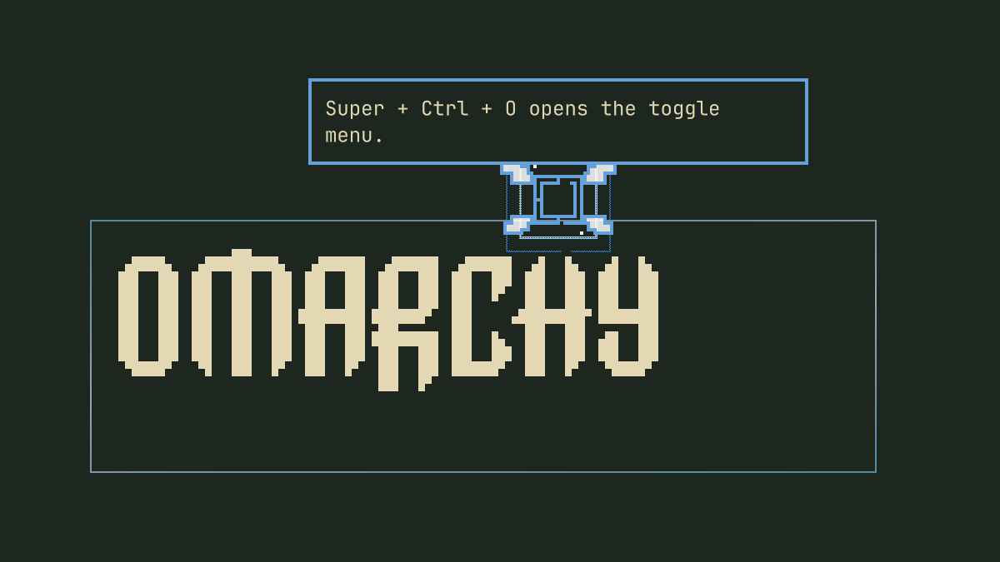

# OmAiry

A small winged Omarchy mark that hangs out on your desktop. Its body is the
Omarchy icon, hollow so your desktop shows through, with block wings and a
block-art glow that echoes outward from it, all coloured from your theme. It
flies in long lazy arcs, visits the window you're working in, and sometimes
perches on top of it to rest.

Click it and it shares something to learn about Omarchy, a keybinding or a command
("Super + K shows every keybinding."), in a card styled like Omarchy's own popups.

## Install

    omarchy plugin add https://github.com/Tiedeyez/omairy --enable

It appears straight away on your focused monitor. No other setup.

## Remove

    omarchy plugin remove tiedeyez.omairy

To keep it installed but stop it starting with the shell:

    omarchy plugin disable tiedeyez.omairy

## Commands

    omarchy-shell tiedeyez.omairy toggle   # hide/show (this session)
    omarchy-shell tiedeyez.omairy summon   # fly to the focused window
    omarchy-shell tiedeyez.omairy poke     # share a tip
    omarchy-shell tiedeyez.omairy demo     # show everything it can do (about 40 s)

## Behaviour

- Flies in long, lazy arcs, floating gently up and down, and now and then
  turns a little loop in the air. No two flights take the same path.
- Lives on the Top layer, so fullscreen windows cover it, and it stops
  animating while the workspace has a fullscreen window.
- Holds still when `omarchy toggle animations` is off.
- Only a small area around the fairy takes clicks; everywhere else, clicks
  pass straight through to your windows.
- Stays out of space the bar or a dock reserves, on any edge.
- Every few minutes, at random, a small mark or emoticon (`!`, `?`, `:)`,
  `zzz`) pops up over its head for a moment. No reason given.
- The card uses your system font and your theme's popup colours.
- Tips are Omarchy's default keybindings and commands. If you have rebound keys, yours may
  differ; edit `i18n/en.json` to change or add lines.

## Requirements

Omarchy with the Quattro shell (omarchy-shell). No other dependencies.

## What it does on your machine

See [DISCLOSURE.md](DISCLOSURE.md). Short version: it runs inside the shell,
starts no processes, reads and writes no files, and makes no network requests.

## Licence and credits

MIT. The body is the Omarchy icon mark, redrawn as a 15x15 pixel grid from
Omarchy's own `icon.png`. Omarchy is MIT licensed, copyright David Heinemeier
Hansson. OmAiry is a community plugin and is not an official part of Omarchy.
The wings, glow and behaviour are original, drawn as text grids in `Sprite.js`.
